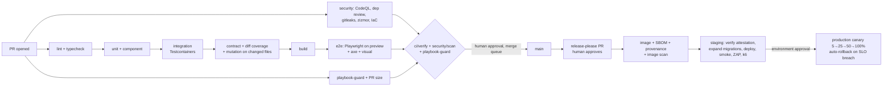

# 8. CI/CD and deployment

## 8.1 Reference pipeline



Ordering principles: cheapest and most deterministic checks first, so agents get fast feedback; security scans run in parallel and never wait on tests; anything needing a deployed app (e2e, DAST) runs last.

Time budgets (p50): PR pipeline ≤ 15 min; main to staging ≤ 20 min; staging to production ≤ 60 min including canary. If exceeded, the platform team treats it as a defect.

Reusable implementations: `.github/workflows/reusable-ci-node.yml`, `reusable-ci-python.yml`, `reusable-security.yml` in this repo; project wrappers in `templates/project/.github/workflows/`.

## 8.2 Environments

| Environment | Created | Data | Deploy trigger | Access |
|---|---|---|---|---|
| Local | Developer/agent machine | Synthetic seeds | — | Developer |
| Preview | Per PR (frontend and BFF), torn down on close | Synthetic | PR push | Org members; never public without auth |
| Staging | Long-lived, production-like | Synthetic or masked (never raw production) | Release published | Engineers |
| Production | — | Real | Approval in GitHub Environment `production` | Deploy role via OIDC only |

Rules: same image digest promoted through environments (build once); environment differences only via config; infrastructure changes via IaC PRs with `plan` output attached and `apply` run by the pipeline, never by humans or agents from laptops.

## 8.3 Database migration safety

| Step | Release N | Release N+1 | Release N+2 |
|---|---|---|---|
| Add column | Add nullable column; code writes both old and new | Backfill job; code reads new | Add NOT NULL / constraint `NOT VALID` then `VALIDATE` |
| Rename column | Add new column + dual write | Backfill; switch reads | Drop old column (after verifying no reads) |
| Add index | `CREATE INDEX CONCURRENTLY` in its own migration (non-transactional) | — | — |
| Drop table | Stop all reads/writes; deploy | Verify via logs/query stats for one week | Drop |

Pipeline guarantees: migrations run before the new code (expand only), are linted by Squawk, run with `lock_timeout` and `statement_timeout`, and must be backward compatible with the running version (tested by running the previous release's integration suite against the new schema in CI for High-tier PRs).

## 8.4 Progressive delivery and rollback

| Mechanism | When | Rollback |
|---|---|---|
| Feature flags (OpenFeature + provider) | Any user-visible change of tier Medium/High | Flag off (seconds) |
| Canary (5% → 25% → 50% → 100%, 10 min analysis each) | Every production deploy | Automatic on SLO breach: error rate > SLO burn threshold or p99 latency > target |
| Blue/green | Stateful services where canary is impractical | Switch traffic back |
| Revert PR | Code defect not covered by flag | Revert merged within 30 min target; redeploy |

Rollback must never require a down-migration: expand/contract keeps the previous release compatible with the current schema.

## 8.5 Observability requirements (definition of "production-ready")

| Requirement | Detail | Check |
|---|---|---|
| OB-1 Traces | OpenTelemetry SDK; W3C trace context propagated across services | Trace visible end to end in staging smoke |
| OB-2 Metrics | RED (rate, errors, duration) per endpoint; USE for resources; business KPIs | Dashboard exists before first prod deploy |
| OB-3 Logs | Structured, correlated by `traceId` (§4.5) | Log query in runbook |
| OB-4 SLOs | Availability and latency SLOs per user-facing service; error budget policy (freeze features when budget exhausted) | SLO doc in repo `docs/slo.md` |
| OB-5 Alerts | Multi-window burn-rate alerts on SLOs; every alert links a runbook | Alert review quarterly |
| OB-6 Deployment markers | Deploy events annotated on dashboards with version and PR | Deploy workflow step |

## 8.6 Release notes automation

release-please groups commits by type into per-component release notes; the release PR is where a human adds "Upgrade notes" for breaking changes; on publish, the deploy workflow posts the notes and the attestation link to the release channel. Agent-authored changes appear with the PR number, which links to the disclosure.

### 8.6.1 Multi-package repos (several images from one release workflow)

The project template `release.yml` is written for **one** package: one image (`IMAGE`), one Dockerfile `context`, and the top-level `tag_name` output of release-please. When `release-please-config.json` lists several `packages`, release-please releases them independently and **does not set the top-level `tag_name`**. Instead it sets `paths_released` (a JSON array of package paths) and per-package outputs such as `<path>--version` and `<path>--tag_name`. Turning the template into a fixed matrix of all services while keeping `tag_name` produces images tagged `name:` (empty), which `docker build` rejects. It also builds every image even when only one package was released.

Adapt it like this:

1. In the `release-please` job, add a step after the release-please action that builds the matrix from the outputs, and expose it as a job output (`matrix: ${{ steps.matrix.outputs.matrix }}`):

   ```yaml
   - id: matrix
     if: steps.rp.outputs.releases_created == 'true'
     env:
       RP_OUTPUTS: ${{ toJSON(steps.rp.outputs) }}   # pass outputs via env, never inline in `run` (zizmor template-injection)
     run: |
       matrix=$(printf '%s' "$RP_OUTPUTS" | jq -c --arg repo "${GITHUB_REPOSITORY,,}" '
         {"apps/web": "web", "services/api": "api", "services/worker": "worker"} as $services
         | {include: [ (.paths_released | fromjson[]) as $path
             | select($services[$path] != null)
             | { service: $services[$path], context: $path,
                 version: .[$path + "--version"],
                 image: "ghcr.io/\($repo)-\($services[$path])" } ]}')
       echo "matrix=$matrix" >> "$GITHUB_OUTPUT"
   ```

   Replace the path → service map with your packages.
2. In `build-and-attest`, use `strategy: {fail-fast: false, matrix: ${{ fromJSON(needs.release-please.outputs.matrix) }}}`, guard the job with `needs.release-please.outputs.matrix != ''`, and use `${{ matrix.image }}`, `${{ matrix.version }}` and `${{ matrix.context }}/Dockerfile` (with `context: .` when Dockerfiles copy workspace packages) instead of `IMAGE`, `tag` and the fixed context.
3. **Image names must be lowercase.** `github.repository` keeps the owner's capitals (`My-Org/app`); GHCR rejects `ghcr.io/My-Org/...`. The `${GITHUB_REPOSITORY,,}` above lowercases it.

Reference implementation: the timesheet repo's `release.yml` after the fix for empty image tags (three packages: `apps/web`, `services/api`, `services/worker`).
