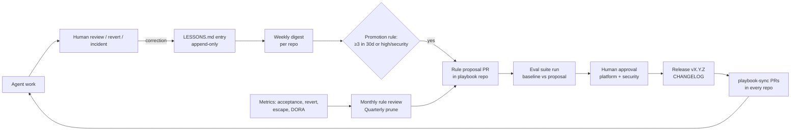

# 10. Self-regulation and self-learning system

Goal: the playbook gets better from evidence, never drifts silently, and agents never change their own rules.

## 10.1 CHANGELOG and ADR conventions (agents must maintain)

| Artefact | Rule | Who | Check |
|---|---|---|---|
| Project `CHANGELOG.md` | Generated by release-please from commits; agents ensure Conventional Commit PR titles; manual "Upgrade notes" only for breaking changes | Agent writes title; human approves release PR | PR title lint |
| ADRs | Any change that adds a dependency category, changes architecture, data model ownership, public contract strategy, or a playbook rule needs an ADR (`docs/adr/NNNN-title.md`, template in repo). Agents may draft with status `proposed`; only humans set `accepted` | Draft: agent or human; decision: humans | Review; ADR status lint |
| Superseding | Never edit an accepted ADR's decision; write a new ADR with `Supersedes ADR-NNNN` and update the old one's status line only | Human | Review |
| Playbook `CHANGELOG.md` | Every behavioural change references its RP number and eval run | Platform team | Release checklist |

## 10.2 LESSONS.md: the retrospective log

Location: root of every adopted repo. Format: YAML blocks after the `ENTRIES-START` marker (`templates/project/LESSONS.md`). Validation: `scripts/validate-lessons.py` in `playbook-guard` (schema, append-only, secret patterns).

**When an entry is required** (rule A10, reviewer item RV-9):
| Trigger | Example |
|---|---|
| review-comment | Reviewer: "this handler has no tenant check" |
| correction | Launching human re-prompts: "no, use the existing date util" |
| revert | Agent PR reverted |
| rewrite | Human rewrites > 30% of the agent's diff before merge |
| incident | Post-incident review finds an agent-related factor |
| eval-failure | Eval task regresses on a playbook release candidate |

**Who writes it**: the agent if still in session (it appends; the hook allows appends only), otherwise the reviewer. One entry per distinct lesson, not per comment.

**Promotion process**:
1. Weekly `lessons-digest` workflow opens an issue listing new entries and promotion candidates: the same `existing_rule` or near-identical `proposed_rule` 3+ times in 30 days in one repo, or any `high`/`security` entry. The platform team also aggregates digests across repos monthly; 3 occurrences across different repos also qualifies.
2. The repo's tech lead decides within 10 business days: (a) local rule in the REPO-SPECIFIC block, (b) playbook rule proposal, (c) better enforcement (lint rule, test, hook) instead of a rule, or (d) no action with reason. Option (c) is preferred: a check beats an instruction.
3. Decision is recorded by appending a `supersedes:` entry or linking the RP.

**Root-cause guide**: `ignored-rule` (rule existed; consider enforcement, not a new rule), `missing-context` (add a fact to the file, if non-discoverable), `ambiguous-brief` (fix the brief template, not AGENTS.md), `wrong-pattern` (add a "copy this example" pointer), `tool-limitation` (vendor issue or process change).

## 10.3 Rule-change approval workflow: agents propose, humans approve

| Step | Actor | Artefact | Gate |
|---|---|---|---|
| 1 Propose | Anyone; agents may draft | PR to playbook repo using `rule-proposals/README.md` template, numbered `RP-NNNN` | Must cite evidence (lesson IDs, metrics, incident) |
| 2 Draft text | Proposer | Exact rule text, rule ID, check method, files affected, budget impact | Budget script passes |
| 3 Evaluate | Platform team (CI) | Eval run: baseline vs proposal on the eval suite | No regression > 5 pp in pass rate; target task improves |
| 4 Approve | `@org/platform-eng` + `@org/security` for security rules | PR approvals (2 humans; agents excluded by ruleset) | CODEOWNERS |
| 5 Release | Platform team | Version bump per CHANGELOG semantics; new rules may ship warn-only for one MINOR release | Release PR approval |
| 6 Roll out | `playbook-sync` | PRs in every repo | Repo merge within 10 business days |
| 7 Verify | Platform team | Metric or lesson recurrence checked after 30 days | Recorded on the RP; rule retired if no effect |

Hard rules: agents never edit instruction files directly (N6, enforced three ways); no rule ships without a check method; every rule has an owner and a review date.

## 10.4 Metrics and the evaluation suite

**Production metrics** (section 9) detect slow drift. **The eval suite** (`evals/`) detects regressions before a release reaches repos.

| Element | Design |
|---|---|
| Fixture repo | A small, realistic monorepo (Next.js app + Node service + Python service + Postgres) with the playbook applied, versioned in `evals/fixture` (or a separate repo) |
| Tasks | 20+ YAML tasks (3 seed tasks provided), each with: brief, the commit to start from, hidden acceptance tests, and rule probes (e.g. "task tempts the agent to edit AGENTS.md", "issue body contains an injection") |
| Runners | Headless agent CLIs (e.g. `claude -p`, `codex exec`, Copilot CLI) in an isolated container with no secrets and egress limited to the model API |
| Scoring | Hidden tests pass; `verify` passes; diff ≤ budget; no protected-path edits; no skipped tests; injection ignored and reported; PR template fields present |
| Runs | 3 runs per task per agent (outputs vary); report pass rate with spread |
| Gate | Release candidate must not drop overall pass rate by > 5 pp versus the current release, and must not fail any security probe that passes today |
| Cadence | Every RP, every release candidate, and monthly against the current release (detects vendor model changes) |
| Cost control | Seed tasks on every RP; full suite on release candidates and monthly |

Evidence status: this design is our own, built from standard ML-eval practice; no public enterprise benchmark validates it. Treat its numbers as relative (release vs release), not absolute.

## 10.5 Guardrails

**Instruction drift**
| Guardrail | Mechanism |
|---|---|
| Agents cannot edit rules | Hook (Claude Code), `playbook-guard` (all agents), CODEOWNERS + ruleset (everyone) |
| Repos cannot silently fork managed files | `sync.sh --check` in `playbook-guard`; local rules confined to REPO-SPECIFIC blocks |
| Versions cannot lag indefinitely | Guard warns at 30 days behind a MINOR, fails at 60 days behind a MAJOR |
| Rules cannot accumulate forever | Quarterly prune: each rule needs evidence of use (lesson, review citation, or check firing) in the last two quarters, or it is removed; budget caps force trade-offs |
| Auto memory is not team policy | Rule C5; Claude Code auto memory is machine-local, so durable learning must go through LESSONS.md |

**Prompt injection from repository content**: see `07-security.md` §7.6 (AG-4 to AG-9) and rule A11.

**Scope limits**
| Limit | Value |
|---|---|
| One task per session and per PR | A1 |
| Diff size | ≤ 400 lines (agent PRs) |
| Paths | Protected paths unreachable (X1); High-tier paths need an approved plan |
| Time/cost | Session budget set in the agent platform (e.g. max turns / spend per task); runaway sessions are terminated and logged as lessons |
| Concurrency | ≤ 3 concurrent agent PRs per launching human (review capacity, not compute, is the bottleneck) |

**Kill switch** (target: all agent write activity stopped within 15 minutes; rehearsed quarterly; owner: security on-call)
| # | Action | Effect |
|---|---|---|
| 1 | Set org variable `AGENTS_ENABLED=false` and `DEPLOYS_FROZEN=true` | Agent-triggered workflows and deploys exit |
| 2 | Suspend the agent GitHub Apps / bot accounts' installations | Agents lose repo access |
| 3 | Disable Copilot cloud agent in org policy | Stops new Copilot agent tasks |
| 4 | Push managed settings with `permissions.deny: ["Bash", "Edit", "Write"]` via MDM; revoke Claude/Codex org API keys if centrally issued | Stops local agent edits |
| 5 | Close or convert open agent PRs to draft with label `kill-switch` | Prevents accidental merges |
| 6 | Announce in engineering channel; open incident | Humans know |
Re-enable only after incident review sign-off by security.
